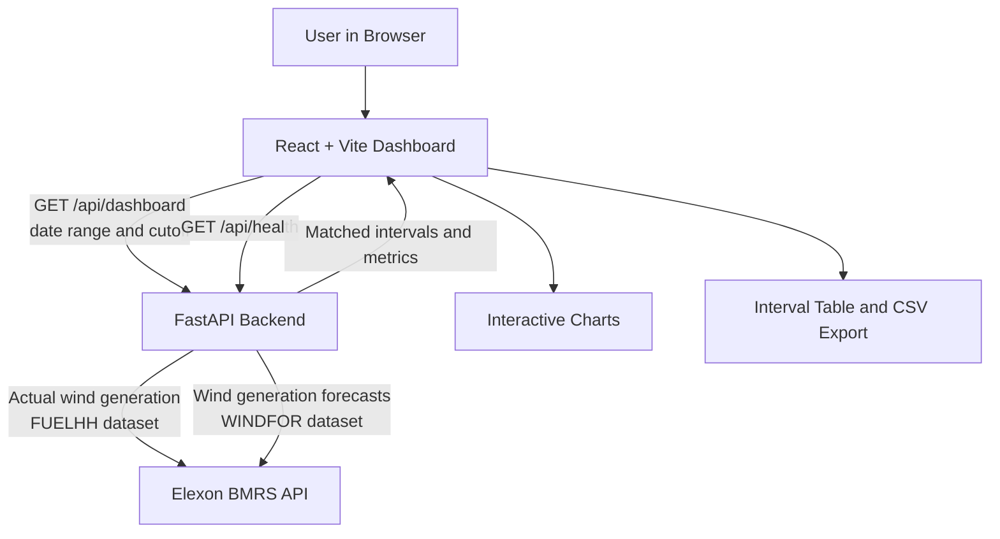

# Wind Forecast Accuracy Dashboard

The Wind Forecast Accuracy Dashboard compares UK wind generation forecasts with actual generation. It helps users review forecast accuracy over a selected delivery period, see where forecasts missed, and inspect the underlying delivery intervals.

## Architecture



The frontend and backend are separate applications. In the current deployment, each is a separate Vercel project. The frontend calls the backend using `VITE_API_URL`. The backend uses `FRONTEND_ORIGINS` to allow browser requests from the deployed frontend domain. There is no application database or authentication system in this project.

## Key Components

1. **Frontend — React and Vite**  
   `frontend/src/main.jsx` implements the dashboard. Users can select a date range and forecast cutoff, inspect summary metrics and interactive charts, search and page through interval details, and export the rows as CSV.

2. **Backend — Python and FastAPI**  
   `backend/main.py` defines `GET /api/health` and `GET /api/dashboard`. It retrieves data, normalizes timestamps, matches forecasts to actual generation, and returns JSON for the dashboard.

3. **Data source — Elexon BMRS**  
   Actual wind generation comes from the `FUELHH` dataset, filtered to the `WIND` fuel type. Wind forecasts come from `WINDFOR`. The backend requests both datasets from Elexon's public API.

4. **Forecast selection and metrics**  
   For each delivery interval, the backend selects the latest forecast published at or before the configured cutoff. The signed error is `forecast - actual`: a positive value means over-forecasting and a negative value means under-forecasting. MAE, RMSE, and bias use only intervals with both forecast and actual values.

5. **Time handling and errors**  
   Delivery periods use the `Europe/London` timezone; timestamps are normalized to UTC for matching. The backend handles upstream request failures, timeouts, and Elexon rate limits. Missing data is not replaced with zero or sample data.

## Codebase Map

```text
backend/
  main.py             FastAPI routes, Elexon requests, matching, and metrics
  requirements.txt    Python dependencies
  railway.json        Optional Railway start command and health check

frontend/
  index.html          Vite entry page
  package.json        React and Vite scripts and dependencies
  vercel.json         Vite install, build, and output settings
  src/main.jsx        Dashboard, API call, charts, filters, and interval table
  src/styles.css      Main visual styling
  src/responsive-overrides.css
```

## Configuration

### Frontend

The local frontend defaults to `http://localhost:8000`. Optionally create `frontend/.env.local`:

```env
VITE_API_URL=http://localhost:8000
```

For the deployed Vercel frontend, set `VITE_API_URL` to the backend base URL, without an API path:

```env
VITE_API_URL=https://<your-backend-domain>
```

Vite reads this variable during the build, so redeploy the frontend after changing it.

### Backend

For the deployed backend, set `FRONTEND_ORIGINS` to the exact frontend origin:

```env
FRONTEND_ORIGINS=https://<your-frontend-domain>
```

Do not add a page path or trailing slash. Multiple allowed origins can be comma-separated. Locally, the backend defaults to allowing `http://localhost:5173` and `http://127.0.0.1:5173`.

## Local Setup

### 1. Start the backend

In PowerShell:

```powershell
cd backend
py -m venv .venv
.venv\Scripts\Activate.ps1
pip install -r requirements.txt
uvicorn main:app --reload --port 8000
```

The interactive API documentation is available at `http://localhost:8000/docs`.

### 2. Start the frontend

Open a second terminal:

```powershell
cd frontend
npm install
npm run dev
```

Open the Vite URL printed in the terminal, normally `http://localhost:5173`.

## API Endpoints

- `GET /api/health` — confirms that the API is responding.
- `GET /api/dashboard?start_date=2026-01-01&end_date=2026-01-31&cutoff_hours=12` — returns matched delivery intervals and summary metrics. The date range is limited to 31 days or less.

## Analysis Assumption

The cutoff determines how many hours before delivery a forecast must have been published to be eligible. The app selects the latest eligible publication. This is an analytical assumption, not a verified market gate-closure deadline. The second-half indicator compares mean absolute error across the two halves of the period; it describes an average change and does not imply that every individual forecast improved.
